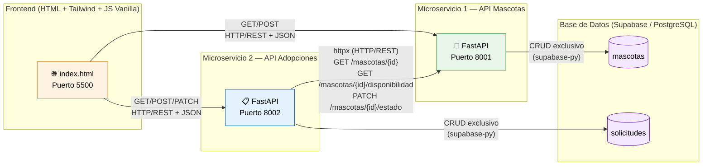
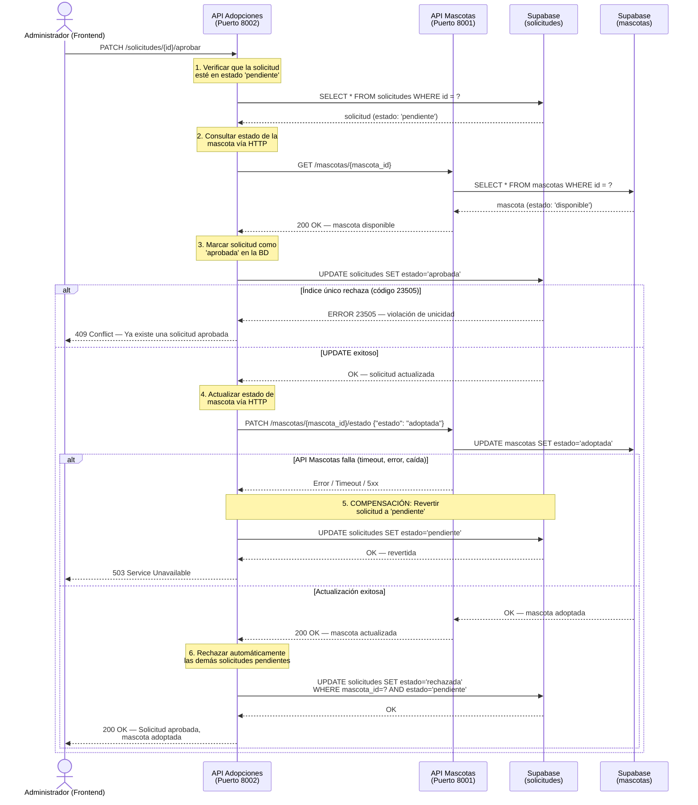
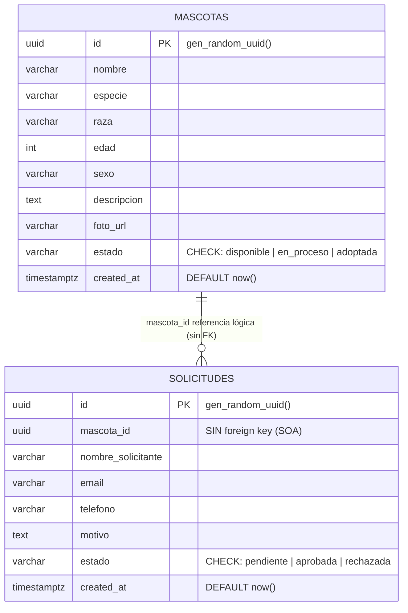

# Arquitectura del Sistema — Fundación Huellas de Esperanza

## 1. Diagrama de Componentes (SOA)

> **Principio clave:** cada microservicio accede **únicamente** a su propia tabla.  
> API Adopciones **nunca** consulta la tabla `mascotas` directamente; toda la información de mascotas llega por HTTP a través de API Mascotas.

---

## 2. Diagrama de Secuencia — Flujo de Aprobación

---

## 3. Diagrama Entidad–Relación

> **Nota importante:** `solicitudes.mascota_id` **no tiene FOREIGN KEY** hacia `mascotas.id`.  
> Esto es intencional en SOA: cada servicio es dueño exclusivo de su tabla y no se crean dependencias cruzadas a nivel de base de datos. La validación de existencia se hace por HTTP en tiempo de ejecución.
>
> Un **índice único parcial** `uq_solicitudes_aprobadas_por_mascota` en `solicitudes(mascota_id) WHERE estado = 'aprobada'` garantiza a nivel de base de datos que solo pueda existir una solicitud aprobada por mascota, retornando error PostgreSQL `23505` que la API traduce a `409 Conflict`.

---

## 4. Despliegue en la Nube (Producción en Render)

El sistema opera en producción bajo una topología de 3 servicios desacoplados:

| Componente | Tipo de Despliegue | URL Pública |
|---|---|---|
| **Frontend Web** | Static Site | [`https://huellas-de-esperanza-jytk.onrender.com`](https://huellas-de-esperanza-jytk.onrender.com) |
| **API Mascotas** | Web Service (Docker / Python) | [`https://api-mascotas-d63k.onrender.com/docs`](https://api-mascotas-d63k.onrender.com/docs) |
| **API Adopciones** | Web Service (Docker / Python) | [`https://api-adopciones-ldy0.onrender.com/docs`](https://api-adopciones-ldy0.onrender.com/docs) |
| **Base de Datos** | PostgreSQL Gestionado | `hekscpryhwnjjhjcyfjt.supabase.co` |

---

## 5. Garantías de Consistencia y Tolerancia a Fallos

1. **Aislamiento de Microservicios:** Ningún microservicio conoce las credenciales ni la tabla del otro. La única vía de integración es el protocolo HTTP/REST.
2. **Transacción Compensatoria (Saga Básico):** Si durante la aprobación de una solicitud `api-mascotas` deja de responder o devuelve error, `api-adopciones` ejecuta de inmediato una compensación revirtiendo la solicitud a `pendiente` y respondiendo con código HTTP `503 Service Unavailable`.
3. **Idempotencia de Estados:** Las actualizaciones de estado en `/mascotas/{id}/estado` son idempotentes; múltiples solicitudes con el mismo estado producen el mismo resultado sin efectos colaterales.
4. **Validaciones en Tiempo Real:** Antes de aceptar una solicitud de adopción, `api-adopciones` valida que la mascota exista y esté en estado `disponible` llamando a `api-mascotas`. Si no está disponible, responde `400 Bad Request`.

